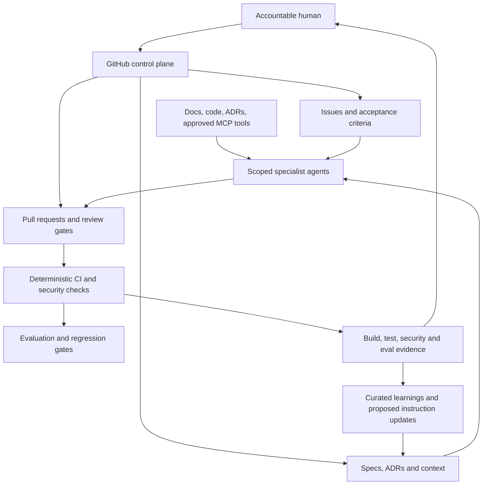

# Dynamic Agentic Development Harness — Roadmap

**Status:** Proposed evolution plan  
**Principle:** Automate repeatable verification and context assembly; keep accountable human decisions explicit.

This roadmap extends the [Ways of Working](ways-of-working.md), [SDLC protocol](sdlc.md), [MCP guidance](../engineering/mcp-and-agent-skills.md), and [AI security testing](../security/ai-agent-security-testing.md). Ship dependable controls before adding autonomous orchestration.

## Target architecture



## Five lifecycle phases

| Phase | Human accountability | Agent work | Exit evidence |
|---|---|---|---|
| 1. Discovery and inception | Business intent, priority, boundaries and acceptance criteria | Inspect context, identify unknowns, draft options and plan | Approved scope and measurable acceptance criteria |
| 2. Design and architecture | Approve material trade-offs, data contracts and risk | Draft ADRs, schemas, API contracts, threat model and test plan | Reviewed specification and recorded decisions |
| 3. Execution and refinement | Resolve ambiguity and oversee scope | Decompose work, implement increments, update docs and tests | Reviewable changes mapped to acceptance criteria |
| 4. Verification and deployment | Accept residual risk and authorise production changes | Run deterministic checks, security scans, evals and independent review | Reproducible evidence, required gates and rollback plan |
| 5. Governance and evolution | Validate outcomes and approve policy changes | Summarise metrics, detect recurring failures, propose improvements | Retrospective, owners and follow-up items |

## Pillar 1 — MCP and workspace context (Phase 1)

- Repository instructions and approved configuration remain the durable contract; MCP is a capability adapter, not a policy authority.
- Provide optional servers for GitHub, local documentation/search, approved database schemas and vector retrieval only when needed.
- Default to read-only scopes. Require explicit authorisation for write, delete, merge, secret, deployment or production tools.
- Use environment placeholders or an approved secret manager. Never store credentials in `.mcp.json`, prompts or committed local settings.
- Pin packages where supported, document data egress, and inspect server provenance before enabling connectors.
- Clearly label examples; do not imply that a database, vector store or MCP server is already configured.

**Acceptance:** configuration validates, setup/teardown is documented, permissions and data flows are reviewed, and an offline path remains available.

## Pillar 2 — Deterministic guardrails (Phase 1)

- Pre-commit checks detect merge markers, private keys, malformed configuration and formatting drift.
- CI runs stack-appropriate lint, type checks, tests, builds, dependency/secret scans and policy checks.
- Validate schemas and API contracts where they exist; avoid brittle AST rules that reject valid project-specific code.
- Use minimal workflow permissions, pinned third-party actions, untrusted-event isolation, protected environments and short-lived identity.
- Keep required checks meaningful. Fix failures; never disable a real security control merely to turn CI green.

**Acceptance:** controls run locally and in CI, emergency bypass is documented, and a representative policy violation is detected by a test.

## Pillar 3 — Spec-driven engineering and evaluations (Phase 2)

Suggested optional `evals/` structure:

```text
evals/
├── README.md
├── datasets/        # synthetic or approved, non-sensitive fixtures
├── cases/           # versioned inputs and expected behaviour
├── runners/         # deterministic harnesses
├── reports/         # generated reports; avoid sensitive committed output
└── benchmarks/      # latency, cost and quality baselines
```

- Start with deterministic tests and explicit pass/fail criteria.
- Add model-based evaluations for groundedness, tool selection, policy adherence, refusal correctness and task completion where relevant.
- Track model, prompt, dataset and evaluator versions; protect test sets from leakage.
- Use thresholds and human adjudication for noisy model-based scoring.
- Keep production data out of fixtures unless authorised and appropriately de-identified.

**Acceptance:** baseline reports are reproducible, regressions visible in PRs, and probabilistic thresholds include limitations.

## Pillar 4 — Specialist agents and safe orchestration (Phase 2)

- **Architect:** requirements, trade-offs, ADRs, contracts and threat models; cannot unilaterally approve its own design.
- **Developer:** implements approved scope and tests; cannot bypass required gates.
- **Reviewer:** independently checks correctness, risk, tests and maintainability.
- **SecOps:** threat models, secret/dependency/workflow checks and remediation advice; policy changes remain human-owned.
- **Test / QA:** derives tests from acceptance criteria and reports reproducible evidence.
- **Orchestrator:** decomposes work and reconciles outputs; receives only tools needed to coordinate.

Start with sequential handoffs and explicit files. Add parallel agents only for isolated tasks, with one coordinator responsible for conflict resolution and the final test suite.

**Acceptance:** each role has defined inputs, outputs, permissions, escalation conditions and a human owner for decisions it cannot make.

## Pillar 5 — Curated episodic memory and local retrieval (Phase 3)

- Index approved source files, ADRs, changelog entries and selected issue/PR metadata.
- Respect repository ACLs and data classification; do not expose content the requesting identity cannot access.
- Record source links and timestamps so retrieved context can be verified against current source.
- Support deletion and re-indexing when documents are removed or access changes.
- Keep generated embeddings and caches out of Git unless a clear reproducibility need justifies them.
- Treat retrieval as a relevance aid, not a substitute for current source or tests.

**Acceptance:** access controls are tested, stale results identifiable, re-indexing documented, and offline operation possible.

## Phased delivery

| Phase | Deliverables | Gate |
|---|---|---|
| 1 — Reliable foundation | Instruction contract, issue/PR templates, MCP safety, pre-commit, CI and security checks | Reproducible checks; no unreviewed privilege |
| 2 — Evaluated specialists | Eval harness, role prompts, independent review and orchestration protocol | Regression tests and human escalation demonstrated |
| 3 — Memory and retrieval | Permission-aware indexing, provenance, retention/deletion and freshness | Access-control and stale-context tests pass |

## Operating rules

1. Prefer small PRs and a green, deployable `main`.
2. Agents execute within scope; humans own business outcomes, risk acceptance and production authority.
3. An agent never approves its own PR or bypasses required protections.
4. Auto-merge is permitted only under explicitly configured policy after all required checks and independent approvals pass.
5. Measure outcomes, escaped defects, lead time, rework, reliability and cost—not generated lines of code.
6. Every phase ends with evidence, a retrospective and a named next action.
