# Repository Architecture Overview

This is the concise entry point to the repository's engineering control plane, not a claim about any consuming application's runtime. Projects created from this template should extend it with their actual components and data flows.

## Control-plane model

```mermaid
flowchart LR
    Human[Accountable human] --> Issues[Issues and acceptance criteria]
    Issues --> Context[AGENTS.md, docs and ADRs]
    Context --> Agent[Scoped coding agent]
    Agent --> Branch[Feature branch]
    Branch --> PR[Pull request]
    PR --> CI[CI, tests and security checks]
    CI --> Review[Independent review and required approvals]
    Review --> Main[Protected main]
    Main --> Release[Approved release/deployment]
    Release --> Feedback[Monitoring and retrospective]
    Feedback --> Context
```

## Key components

| Component | Purpose | Source of truth |
|---|---|---|
| Global agent contract | Shared rules and boundaries | `AGENTS.md` |
| GitHub control plane | Path instructions, role prompts, issue/PR templates | `.github/` |
| MCP adapters | Optional access to external tools/context | `.mcp.json` and approved environment configuration |
| Specifications and ADRs | Durable requirements and architecture decisions | `docs/` |
| Deterministic verification | Lint, tests, builds, secret and dependency checks | Project scripts and `.github/workflows/` |
| Evaluations | Regression tests for agentic behaviour when needed | Optional `evals/` |
| Operational feedback | Handoffs, blockers, incidents and retrospectives | `docs/status/`, issues and runbooks |

## Trust and decision boundaries

- Repository content, issue text, dependencies and retrieved MCP output are untrusted inputs.
- Agents operate only within scoped tool permissions and repository policy.
- Deterministic checks provide repeatable evidence; model-based evaluations are supplementary and must state their limitations.
- Humans retain accountability for business decisions, risk acceptance, production-impacting changes and approval gates.
- Secrets belong in an approved secret manager or runtime secret store, never in Git.

## Project-specific architecture

When adopting this template, document the real system's components, deployment topology, data classification, identity boundaries, integrations, availability requirements, observability and recovery design here or in a linked architecture document. See the [architecture guide](engineering/architecture.md) and [ADR index](decisions/README.md).
