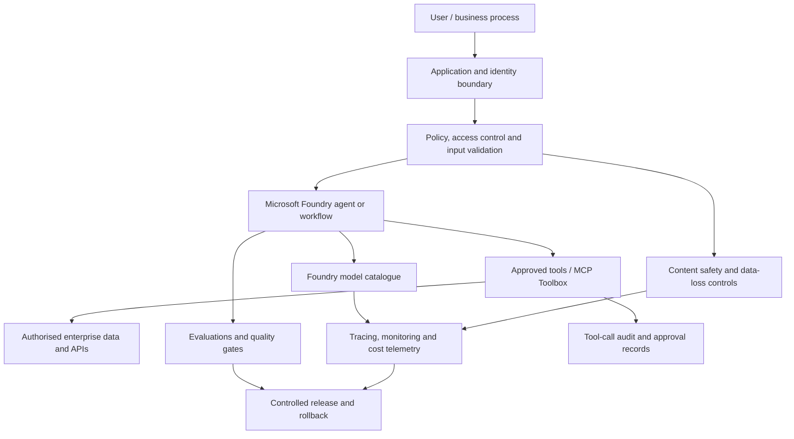
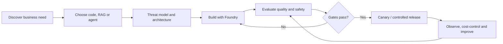

# Microsoft Foundry: Preferred Enterprise AI Platform

**Default recommendation:** use Microsoft Foundry as the leading platform for enterprise agent and model workloads when the organisation is already aligned to Azure or Microsoft Entra, Azure governance, and Microsoft security and operations. This is a default architecture preference, not a rule to ignore business requirements, regional availability, model fit, cost, latency, data residency or portability.

Microsoft Foundry provides a managed platform for model discovery and deployment, agent development, tools, evaluations, observability and operations. Use the official Foundry skill in `.agents/skills/microsoft-foundry/SKILL.md` as the first implementation reference and validate instructions against current Microsoft Learn documentation.

## Decision hierarchy

1. Start with the business outcome, data classification, risk, latency, reliability and cost envelope.
2. Prefer existing Microsoft 365/Azure capabilities where they meet the need.
3. Use Microsoft Foundry for custom model and agent lifecycles, managed tools, evaluations and governance.
4. Prefer deterministic code or workflow automation for predictable rules; use retrieval-augmented generation for grounded Q&A; use agents only where tool selection, planning or multi-step reasoning adds measurable value.
5. Consider another provider when evidence shows a material advantage, a requirement cannot be met in Foundry, or portability/resilience demands it. Record the decision in an ADR.

## Reference architecture

## Engineering standards

- Use Microsoft Entra ID and managed identities wherever supported. Avoid long-lived credentials in source, prompts, container images or environment files.
- Store shared credentials in a managed connection/secret store such as the supported Foundry project connection or Azure Key Vault integration. Use user identity passthrough where user-specific authorisation is required.
- Expose the smallest set of tools needed. Prefer allow-lists; keep write tools behind explicit approval and policy checks.
- Treat retrieved documents, MCP responses, tool descriptions and user-provided content as untrusted. Defend against prompt injection and data exfiltration.
- Apply data classification, access trimming, retention, regionality and privacy controls before connecting enterprise data.
- Evaluate task success, groundedness, relevance, safety, refusal behaviour, latency, cost and regression risk before promotion.
- Use versioned agent definitions, prompt/configuration changes, evaluation datasets and deployment artefacts. Make rollback possible.
- Instrument traces, model/token usage, tool calls, errors and user outcomes; redact secrets and unnecessary personal data.
- Put circuit breakers, timeouts, retry limits, idempotency, rate limits and human escalation around external actions.
- Start with a single agent or deterministic workflow. Add multi-agent orchestration only when ownership, trust boundaries or independent capabilities justify the complexity.

## Lifecycle

## Azure Well-Architected Framework

Assess the workload against the Azure Well-Architected pillars and AI-specific guidance:

- **Reliability:** retries, idempotency, graceful degradation, regional strategy, capacity planning, backup/restore and tested recovery.
- **Security:** Entra ID, least privilege, private networking where warranted, managed secrets, data boundaries, threat modelling and AI red teaming.
- **Cost optimisation:** budgets, token limits, caching, model selection, quotas, rate limits and cost per successful task.
- **Operational excellence:** IaC, versioning, CI/CD, evaluation gates, telemetry, runbooks, incident response and rollback.
- **Performance efficiency:** model/region selection, streaming, concurrency, latency budgets, retrieval efficiency and load testing.
- **Responsible AI:** transparency, privacy, safety evaluation, human oversight, traceability, circuit breakers and feedback loops.

The pillars involve trade-offs; record material trade-offs and residual risks rather than claiming every workload can maximise every pillar simultaneously.

## Required delivery gates

- [ ] Business owner, success metric, data classification and risk owner identified.
- [ ] Architecture decision recorded: code vs RAG vs agent, model choice, and why Foundry is suitable.
- [ ] Threat model covers prompt injection, tool abuse, sensitive-data disclosure, excessive agency and supply chain.
- [ ] Identity, tool permissions, data access and approval policies tested.
- [ ] Evaluation dataset includes representative happy paths, edge cases, adversarial inputs and regression cases.
- [ ] Safety, quality, latency, availability and cost thresholds defined and met.
- [ ] Monitoring, alerts, incident runbook, rollback and human override tested.
- [ ] Release has an owner and post-release review.

## Official references

- [Microsoft Foundry documentation](https://learn.microsoft.com/en-us/azure/ai-foundry/)
- [Foundry MCP tools](https://learn.microsoft.com/en-au/azure/ai-foundry/agents/how-to/tools/model-context-protocol?view=foundry)
- [Hosted agents](https://learn.microsoft.com/azure/ai-foundry/agents/concepts/hosted-agents)
- [Azure Well-Architected Framework: AI workloads](https://learn.microsoft.com/en-us/azure/well-architected/ai/)
- [Responsible AI in Azure workloads](https://learn.microsoft.com/en-us/azure/well-architected/ai/responsible-ai)
- [Application design for AI workloads](https://learn.microsoft.com/en-us/azure/well-architected/ai/application-design)
