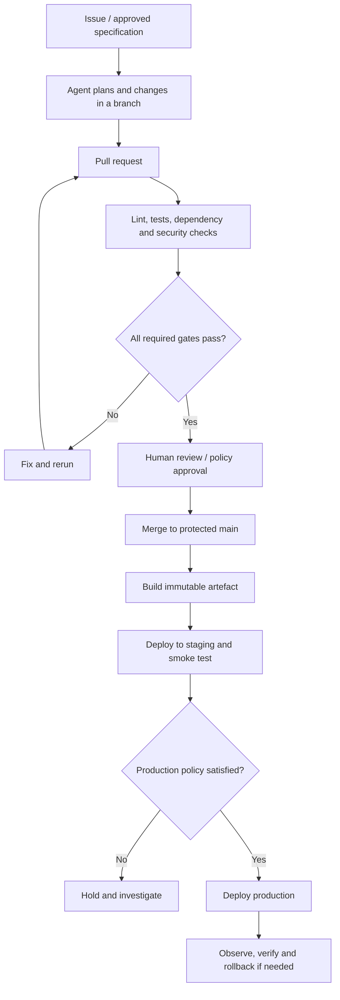

# GitHub Actions and Agentic Workflow Best Practices

GitHub Actions is the automation layer for repeatable engineering controls. AI agents can author or operate workflows, but workflows—not model assurances—must enforce permissions, checks, policy and deployment boundaries.

## Recommended delivery flow



## Workflow rules

1. **Least privilege:** set workflow-level `permissions: contents: read`; grant only required permissions to individual jobs.
2. **Pin actions:** use a verified full-length commit SHA for third-party actions and keep a human-readable version comment. Validate pins automatically.
3. **Protect privileged triggers:** treat `pull_request_target`, `workflow_run`, deployment workflows and write-enabled tokens as high risk. Never check out or execute untrusted PR code in a privileged context.
4. **Separate trust boundaries:** use read-only PR checks; reserve write tokens and deployment credentials for trusted branches and environments.
5. **Use environments:** protect production with branch restrictions, required reviewers and environment-scoped secrets where available.
6. **Use OIDC:** prefer short-lived federated cloud credentials over static Azure credentials.
7. **Control concurrency:** cancel superseded PR runs but avoid cancelling the only run gating a release or merge queue.
8. **Use timeouts and bounded retries:** prevent stuck jobs and runaway cost.
9. **Cache safely:** key caches on lockfiles and toolchain versions; never store secrets in caches or share untrusted write caches with privileged jobs.
10. **Treat artifacts as untrusted:** validate downloaded artifacts and pin the workflow/run that produced them before using them in privileged jobs.
11. **Handle outputs safely:** avoid interpolating untrusted event data directly into shell scripts. Pass it through environment variables and quote inputs.
12. **Keep logs clean:** mask secrets, avoid dumping contexts, and retain enough diagnostics for incident response.
13. **Test the workflow:** lint YAML, validate action SHAs, run required checks for `pull_request`, `push` and `merge_group` when relevant, and test failure paths.
14. **Do not bypass controls:** auto-merge only after required checks and review policy are satisfied. An agent must not weaken branch rules or alter the workflow that gates its own change without independent review.

## Agentic workflow guardrails

- Agents can inspect, plan, create branches, edit code, run tests and open PRs within configured scopes.
- Agents should not approve their own PRs, change branch protection, grant permissions, rotate secrets, or deploy production without explicit authorised human approval.
- Require a plan and acceptance criteria before broad or risky changes.
- Keep work small and reversible; preserve unrelated changes and use idempotent automation.
- Verify tests actually ran. Never infer success from a green-looking PR description.
- Use separate read-only review agents where practical, and treat their feedback as evidence rather than authority.
- Record model, tool, prompt/configuration and evaluation changes when they affect production behaviour.

## Reference workflow shape

```yaml
name: CI
on:
  pull_request:
    branches: [main]
  push:
    branches: [main]
  merge_group:

permissions:
  contents: read

concurrency:
  group: ${{ github.workflow }}-${{ github.event.pull_request.number || github.ref }}
  cancel-in-progress: ${{ github.event_name == 'pull_request' }}

jobs:
  test:
    runs-on: ubuntu-latest
    timeout-minutes: 15
    steps:
      - uses: actions/checkout@<VERIFIED_FULL_COMMIT_SHA> # pin a verified release
        with:
          persist-credentials: false
      - name: Run project tests
        run: <PROJECT_TEST_COMMAND>
```

The placeholder SHA and command must be replaced with verified values for the project; this example is a pattern, not a ready-to-run workflow.

## Official references

- [GitHub Actions security hardening](https://docs.github.com/en/actions/security-for-github-actions/security-guides/security-hardening-for-github-actions)
- [Secure use reference](https://docs.github.com/en/actions/reference/security/secure-use)
- [Workflow permissions](https://docs.github.com/en/actions/security-for-github-actions/security-guides/automatic-token-authentication)
- [GitHub Actions deployment environments](https://docs.github.com/en/actions/deployment/targeting-different-environments/using-environments-for-deployment)
