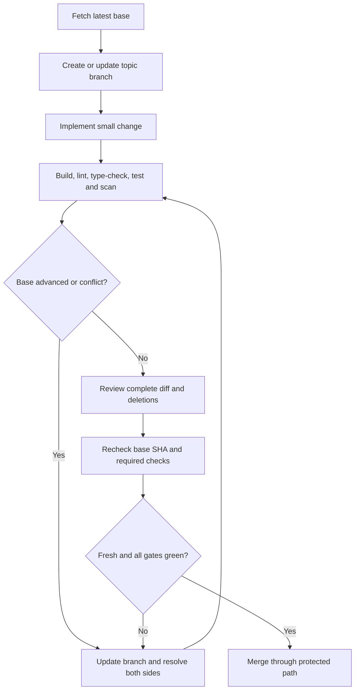

# GitHub Recommendations for Agentic Engineering (October 2026)

**Purpose:** A practical, current baseline for repositories that use human developers, AI coding agents, MCP servers, GitHub automation, and cloud deployment. This is a recommendation set, not a claim that every GitHub feature is enabled on every plan.

**Owner:** Repository maintainers. Review quarterly and after material GitHub platform changes.

## Recommended baseline

1. **Keep visibility deliberate.** Default new product and client repositories to private unless there is a clear, approved reason to publish. Before making a repository public, inspect its full Git history, issues, discussions, releases, Pages artefacts, Actions logs, examples, and configuration for secrets or confidential material. A public repository is a publication, not just a code-hosting preference.
2. **Use a current default branch and short-lived topic branches.** Create branches from the latest base; avoid long-lived branches and never discard work to resolve drift.
3. **Protect the default branch with a repository ruleset.** Require pull requests; block deletion and force pushes; require relevant checks; require up-to-date branches or use a merge queue where supported; resolve review conversations; and limit bypass actors. Apply equivalent controls to release branches when risk warrants it.
4. **Treat freshness as a merge precondition.** Immediately before merge, compare the PR head with the current base. Update the branch, resolve conflicts while preserving both sides, rerun validation, inspect the final diff for deletions/reversions, and recheck freshness. If freshness cannot be verified, do not merge.
5. **Make validation meaningful.** Require a single stable gate (for example, `CI Gate`) that depends on the real build, lint, type-check, test, security, and policy jobs for that stack. Do not configure placeholder checks or make a required check that no longer runs.
6. **Use least-privilege automation.** Set workflow permissions to read-only by default; elevate permissions per job only when required. Pin third-party Actions to reviewed full commit SHAs, use explicit action versions, set concurrency and timeouts, and protect deployment environments.
7. **Enable repository security features where available.** Enable Dependabot alerts and updates, dependency review, secret scanning and push protection, and CodeQL or equivalent code scanning. Add `SECURITY.md`, a vulnerability disclosure process, and an incident/credential-rotation runbook. Verify the plan and repository eligibility rather than assuming a toggle is available.
8. **Keep change records connected.** Use issues for work, acceptance criteria and decisions; PRs for implementation and evidence; releases/changelog for shipped changes. Link PRs to issues and keep documentation, release notes, and public marketing documentation in sync with material product changes.
9. **Make ownership real.** Keep `CODEOWNERS` accurate, review collaborators and GitHub Apps periodically, and use actual teams/users rather than placeholder owners. A CODEOWNERS file does not enforce review unless the ruleset requires it.
10. **Automate safely, not blindly.** Prefer deterministic CI for mandatory gates. Use agentic automation for triage, documentation proposals, test-gap analysis and bounded fixes with constrained permissions and auditable output. Keep a human approval gate for production-impacting or high-risk changes.

## Branch freshness and safe integration

Use this sequence for every PR, whether it was created by a person, a coding agent, a bot, or a sync job:

Do not use force-pushes to hide conflict resolution, do not merge a branch simply because it was green against an older base, and do not automatically accept a generated resolution without reviewing the resulting diff.

## AI agents, MCP and agentic workflows

- **Use a shared repository contract.** Keep durable instructions in `AGENTS.md`; add tool-specific files only when required, and make them point back to the canonical policy. Record project context, architecture decisions, handoff state and acceptance criteria in version-controlled files.
- **Treat MCP servers as privileged integrations.** Approve servers centrally, verify publisher/source and requested tools, use scoped credentials, restrict write-capable tools, and document data flows. Do not add unknown MCP servers or paste credentials into prompts or `.mcp.json`. Prefer secret-manager references and environment injection.
- **Use GitHub Agentic Workflows selectively.** GitHub documents these as a public-preview capability in October 2026. Consider them for bounded issue triage, CI investigation, documentation maintenance and test coverage, but verify current availability and terms first. Keep permissions minimal, declare safe outputs, inspect generated changes, and retain human review for merges and releases. Do not make a preview feature the only control protecting production.
- **Separate propose, implement, review and release responsibilities.** An agent may review its own work as an additional signal, but its self-approval is not independent review. Never let a bot's own approval replace mandatory human approval for a high-risk change.
- **Build feedback loops.** Record failed tests, review feedback, escaped defects and incidents; convert recurring problems into regression tests, reusable skills, workflow checks or clearer instructions.

## Skills, architecture and design quality

- Discover and reuse maintained skills for the current task instead of installing every skill. Review each skill's source, license, permissions, network access, shell commands and update history before adoption.
- For Azure workloads, treat **Microsoft Foundry** as the preferred enterprise AI platform when it fits the project's governance, model choice, networking, identity, evaluation and operational needs. Keep provider boundaries explicit so a justified alternative (such as Amazon Bedrock or Vertex AI) remains possible.
- Use the **Azure Well-Architected Framework** and relevant architecture/security skills as review checklists for reliability, security, cost optimisation, operational excellence and performance efficiency. Adapt recommendations to the actual workload; do not treat a checklist as a substitute for threat modelling or evidence.
- Use diagrams when they improve understanding: Mermaid for architecture, sequence, data-flow and deployment diagrams; keep diagrams close to the documentation they explain and validate them when possible.
- Provide MCP/tool configuration examples that are safe by default. Document required permissions, setup, expected outputs, failure modes and how to revoke access.
- Include accessibility, responsive design, performance, observability, cost and failure recovery in acceptance criteria for user-facing or production systems.

## Suggested pull request checklist

- [ ] Branch was created from the latest base; current base SHA was rechecked immediately before merge.
- [ ] Scope and acceptance criteria are clear; related issue is linked where appropriate.
- [ ] Build, lint, type-check, tests and applicable security checks passed; unrun checks are explicitly reported.
- [ ] Conflicts were resolved without discarding either side's valid work.
- [ ] Final diff was reviewed for accidental deletion, reversion, generated artefacts and unrelated churn.
- [ ] Docs, diagrams, examples, changelog/release notes and relevant marketing documentation were updated.
- [ ] No secrets, customer data or internal-only configuration were added.
- [ ] Permissions and workflow changes follow least privilege.
- [ ] Required reviewers/checks are satisfied; the authoring agent's own review is not misrepresented as independent approval.
- [ ] Rollback, migration and deployment considerations are recorded where relevant.

## Official references

- [GitHub repository best practices](https://docs.github.com/en/repositories/creating-and-managing-repositories/best-practices-for-repositories)
- [Repository rulesets](https://docs.github.com/en/repositories/configuring-branches-and-merges-in-your-repository/managing-rulesets)
- [GitHub agentic workflows](https://docs.github.com/en/copilot/concepts/agent-capabilities/agent-powered-workflows-and-operations/about-github-agentic-workflows)
- [Integrating agentic AI into the SDLC](https://docs.github.com/en/copilot/tutorials/roll-out-at-scale/enable-developers/integrate-ai-agents)
- [Azure Well-Architected Framework](https://learn.microsoft.com/en-us/azure/well-architected/)
- [Microsoft Foundry documentation](https://learn.microsoft.com/en-us/azure/ai-foundry/)
- [Model Context Protocol security best practices](https://modelcontextprotocol.io/specification/draft/basic/security_best_practices)

**Important:** Feature availability, preview status, plan requirements and product names change. Verify current official documentation and repository settings before relying on a capability.
