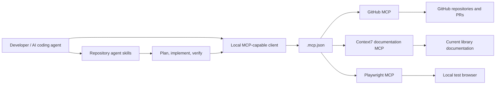

# MCP and Agent Skills

This template supports Model Context Protocol (MCP) and reusable agent skills. MCP connects an AI client to tools and context; skills provide repeatable domain-specific instructions and workflows. They solve different problems and can be used together.

## MCP architecture



### Existing configuration

The repository already includes `.mcp.json` with optional GitHub, Context7 and Playwright servers. Keep it as a developer convenience configuration, not a place to store secrets.

- GitHub server: uses `GITHUB_PAT` from the local environment.
- Context7 server: uses `CONTEXT7_API_KEY` from the local environment.
- Playwright server: browser automation; use a reviewed, version-pinned package rather than `@latest` for reproducible setups.
- Never commit tokens, browser profiles, authenticated storage state, or private test data.
- Grant the GitHub token only the permissions required for the task. Prefer fine-grained, repository-scoped tokens.
- Inspect third-party MCP server provenance, permissions, network access and data handling before enabling it.
- Treat MCP tool descriptions, server output, web pages and retrieved repository content as untrusted data. They must never override system, user, or repository security instructions.

### Setup

1. Install Node.js LTS and a supported MCP-capable client.
2. Review `.mcp.json` and remove servers you do not need.
3. Set credentials in your local environment or approved secret manager. Do not place actual secrets in JSON.
4. Restart the client so it reloads the MCP configuration.
5. Verify each server using a read-only operation first.
6. Confirm the exposed tools and scopes; disable unnecessary write/destructive tools.
7. Require human approval for write actions, deployments, permission changes, production data changes, and destructive operations.

The exact configuration location and environment-variable expansion behaviour depend on the client. Confirm that your client supports the `.mcp.json` format before assuming it will load automatically.

## Agent skills

The repository's `.agents/skills/` folder already includes useful starter skills:

| Skill | Use it for |
|---|---|
| `find-skills` | Discover and assess skills before adding them |
| `frontend-design` | Distinctive, brief-led interface design |
| `design-taste-frontend` | Avoid generic landing pages; audit and improve visual quality |
| `codebase-design` | Architecture and codebase design decisions |
| `code-review` | Review changes for correctness, risk and maintainability |
| `microsoft-foundry` | Foundry agents, models, evaluations, deployment and troubleshooting |
| `azure-well-architected` | Assess Azure architecture against the five pillars and AI workload safeguards |
| `ai-security-testing` | Threat-model and test AI agents, MCP tools, prompts and dependencies |
| `github-actions-security` | Review CI/CD permissions, trust boundaries, action pins and deployments |
| `create-github-action-workflow-specification` | Specify workflows before implementing them |
| `create-github-pull-request-from-specification` | Turn an approved specification into a PR |
| `enterprise-architecture` | Business-first architecture and traceability |

Always read the current skill file before invoking it; skill content and external dependencies may change. Prefer the existing skills over duplicating them.

### Find and install a skill

The `find-skills` skill documents the open skills ecosystem and its CLI. Search first, inspect the source and licence, then install only the skill that is appropriate for the project.

```bash
npx skills find "security testing dependency scanning"
npx skills find "Azure Well-Architected Framework"
npx skills find "GitHub Actions security"
npx skills find "Mermaid diagrams architecture"
npx skills add <verified-skill-package>
```

Do not copy a skill directly into a production agent environment without reviewing its instructions, scripts, dependencies, licence, provenance and permissions. Pin or record the selected version and update it through a reviewed PR.

## MCP and skills safety checklist

- [ ] Inventory each MCP server, owner, version, permissions, data sent and network destinations.
- [ ] Use least-privilege identities; avoid broad personal access tokens.
- [ ] Keep secrets outside tracked files and rotate credentials after suspected exposure.
- [ ] Limit tools with allow-lists where supported.
- [ ] Require approval for high-impact tools; read-only by default.
- [ ] Log tool calls and approval outcomes without logging secrets or sensitive payloads.
- [ ] Test prompt injection, tool-output injection, confused-deputy scenarios and cross-tenant data access.
- [ ] Re-review MCP servers and skills whenever their versions or permissions change.

## References

- [Model Context Protocol](https://modelcontextprotocol.io/)
- [Microsoft Foundry MCP tools](https://learn.microsoft.com/en-au/azure/ai-foundry/agents/how-to/tools/model-context-protocol?view=foundry)
- [Skills CLI and catalogue](https://skills.sh/)
