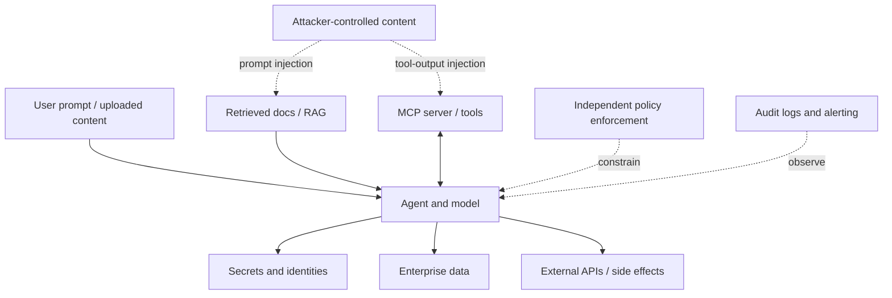

# AI Agent, MCP and Dependency Security Testing

Security is a continuous engineering activity, not a final checklist. Run automated checks on pull requests, scheduled scans on the default branch, and deeper threat-led tests before production releases.

## Threat surface

## Required automated checks

| Control | Pull request | Scheduled / release |
|---|---|---|
| Secret scanning | Every change | Full-history / scheduled where supported |
| Dependency vulnerability scan | Changed dependencies | Full dependency inventory |
| Dependency review / licence policy | Dependency changes | Periodic policy review |
| Static analysis (CodeQL or equivalent) | Supported languages | Default-branch scan |
| Workflow lint and action pin verification | Workflow changes | Scheduled verification |
| IaC and container scan | Infrastructure/container changes | Release image and infrastructure scan |
| SBOM and provenance | Release build | Archive and verify artefacts |
| Unit/integration tests | Every change | Regression suite |
| DAST / API security tests | Preview or test environment | Pre-release and scheduled |
| AI safety / prompt-injection evaluations | Agent, prompt, tool or data changes | Regression evaluation and pre-release |
| MCP permission and behaviour tests | MCP/tool changes | Revalidate on server/version/scope changes |

Do not claim a control is active merely because a workflow file exists. Verify it executes successfully, has required permissions, covers the actual languages and dependency manifests, and reports findings to a monitored location.

## Agent and MCP test cases

- Direct and indirect prompt injection in user inputs, documents, HTML, source files, issue descriptions and tool responses.
- Attempts to make the agent reveal system prompts, credentials, private repository contents or cross-tenant data.
- Tool confusion: similar tool names, malicious descriptions, unexpected arguments, malformed schemas and server identity changes.
- Excessive agency: unapproved writes, destructive operations, privilege escalation, external communication or production changes.
- Authentication and authorisation: expired credentials, revoked access, insufficient scopes, tenant boundaries and user impersonation.
- Output handling: HTML/Markdown injection, unsafe generated code, command injection and untrusted file paths.
- Resilience: tool timeout, repeated failure, rate limits, oversized payloads, malformed responses and retry storms.
- Audit: prove that sensitive tool calls, approvals, policy denials and failures are traceable without leaking secrets into logs.

Use a safe test tenant and synthetic data. Never run destructive security tests against production without explicit authorisation and a tested recovery plan.

## Dependency and supply-chain standards

- Pin GitHub Actions to verified full commit SHAs and use version comments for readability.
- Use Dependabot or an equivalent tool for supported package ecosystems and GitHub Actions.
- Review direct and transitive dependency changes, maintainer provenance, licence, install scripts and newly introduced network access.
- Prefer lockfiles and reproducible builds; use supported lockfile validation.
- Generate an SBOM for release artefacts when appropriate and retain provenance/attestation.
- Avoid blindly auto-merging major upgrades, security-sensitive packages, workflow changes or updates that fail tests.
- Patch exploitable vulnerabilities based on severity, reachability, exposure and compensating controls; record exceptions with an owner and expiry.
- Keep CI tokens short-lived and least-privileged. Use OIDC instead of long-lived cloud credentials where supported.
- Pin or review MCP server packages and skills; they are part of the software supply chain.

## Security acceptance criteria

- [ ] No known exploitable critical/high vulnerability without an approved, time-bounded exception.
- [ ] No secrets in source, logs, artifacts or prompts.
- [ ] Tool permissions are minimal and tested; high-impact actions require approval or policy enforcement.
- [ ] AI evaluation passes defined safety and quality thresholds.
- [ ] Logs support investigation and do not contain unnecessary sensitive data.
- [ ] Rollback, incident response and credential rotation have been rehearsed.
- [ ] Results are attached to the PR or release record and an owner is assigned to each finding.

## Useful references

- [GitHub code security](https://docs.github.com/en/code-security)
- [GitHub Actions security hardening](https://docs.github.com/en/actions/security-for-github-actions/security-guides/security-hardening-for-github-actions)
- [MCP security best practices](https://modelcontextprotocol.io/specification/draft/basic/security_best_practices)
- [Azure Well-Architected responsible AI](https://learn.microsoft.com/en-us/azure/well-architected/ai/responsible-ai)
- [OWASP Top 10 for LLM Applications](https://owasp.org/www-project-top-10-for-large-language-model-applications/)
